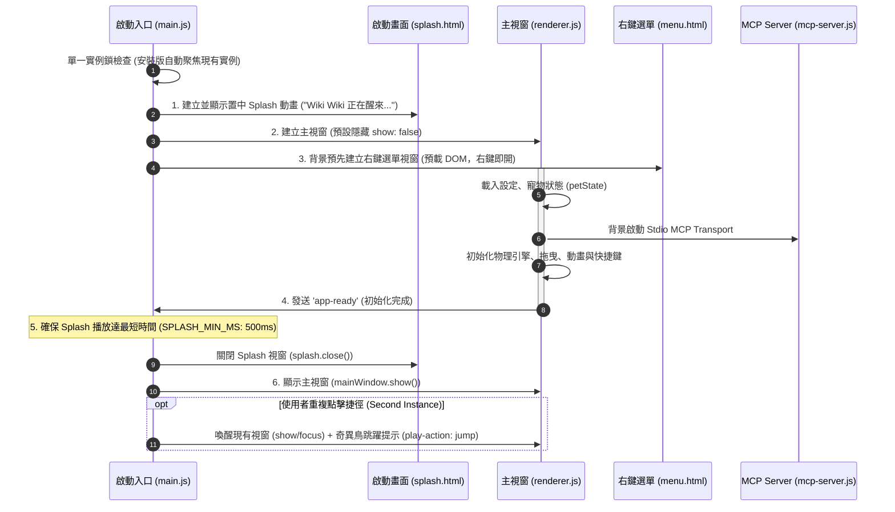

# AI PET (專屬桌面寵物)

這是一個使用 Electron 開發的專屬桌面寵物小助手，外觀是一隻超可愛的圓滾滾奇異鳥 (Wiki Wiki)！

## ✨ 目前已具備的功能 (Features)

- **🖼️ 透明無邊框視窗 (Frameless & Transparent)**
  - 沒有傳統的視窗邊框與背景，奇異鳥會完美融入你的桌面環境。
  - 支援多螢幕邊界自動偵測。

- **🖱️ 滑鼠拖曳 (Draggable)**
  - 可以隨時用滑鼠按住奇異鳥，把牠拖曳到桌面的任何一個角落。

- **🚶 平滑隨機走動 (Smooth Random Movement)**
  - 閒置時會隨機在桌面上走動，採用 60fps 網頁動畫等級的平滑移動運算。
  - **長途跋涉機制**：95% 的機率會在原地附近散步，但有 5% 的極低機率會突然很有精神地長途旅行（走到螢幕另一端）！
  - 當對話框、輸入框開啟，或是處於「專注模式/睡覺模式」時會暫停移動。

- **💬 AI 代理與工具箱 (Gemini AI + MCP Server)**
  - **AI Agent化**：奇異鳥不再只是會聊天的機器人！我們實作了 **Model Context Protocol (MCP)** 伺服器，讓 AI 擁有自己的工具箱。
  - 你可以直接用**自然語言**對牠下達指令，例如：「幫我設一個晚上六點的鬧鐘」、「把買牛奶加到待辦事項」、「你現在心情好嗎？」或「幫我戴上墨鏡」，AI 會自主判斷並呼叫對應的本地功能！
  - 支援對話框連續聊天，並且可以右鍵點擊查看「📜 歷史對話」。

- **⏰ 智慧鬧鐘與提醒 (Alarms)**
  - 你可以直接請 AI 幫你設定鬧鐘（例如「明天早上 8 點叫我起床」），或者從右鍵選單的「鬧鐘設定」面板來管理你的所有定時通知。

- **📋 待辦事項清單 (Todo)**
  - 可以透過語音/文字請 AI 幫你紀錄，或者使用 `/todo [事項]` 加入清單，也能從右鍵選單開啟「待辦事項」面板管理日常任務。

- **🤖 內建快捷小工具 (Commands)**
  - 支援傳統指令模式（輸入 `/` 後按 `TAB` 鍵可自動補齊）：
  - `/md5 [字串]` - 轉換 MD5
  - `/base64 encode/decode [字串]` - Base64 加解密
  - `/uuid` - 產生隨機 UUID
  - `/calc [算式]` - 安全運算式數學計算
  - `/pomodoro [分鐘]` - 番茄鐘專注模式，奇異鳥會進入專注狀態不亂跑，時間到了會提醒你休息。

- **🍎 養成系統與換裝 (Pet State & Outfit)**
  - **餵食 (Feed) & 摸摸 (Pet)**：右鍵點擊可餵食或撫摸，心情好還會冒出愛心 ❤️ 特效。
  - **換裝 (Outfit)**：你可以自己從右鍵選單幫奇異鳥換裝，**也可以直接請 AI 幫你換裝**（例如「你想戴皇冠嗎？」）。
  - **CPU 監控**：自動偵測電腦系統資源，如果 CPU 負載過重，奇異鳥會一起跟著流汗 💦！

- **📁 統一的資料管理 (Data Persistence)**
  - 寵物狀態、聊天歷史紀錄（加密保存）、鬧鐘與待辦事項都會統一且乾淨地儲存在專案的 `data/` 目錄下。

---

## 🔄 應用程式生命週期 (Application Lifecycle)

Wiki Wiki 採用 **Splash 動畫先行 + 背景非同步預熱 (Background Preloading)** 架構，確保視窗啟動平滑無白屏、右鍵選單零延遲響應：



### 生命週期階段說明：
1. **啟動前檢查 (Pre-launch & Single Instance Lock)**：
   - 註冊未捕捉例外攔截 (`logger.js`)。
   - **防重複開啟機制**：正式安裝版（`app.isPackaged`）執行單一實例鎖，若重複開啟，新行程安靜退出並自動聚焦原視窗，讓奇異鳥原地跳一下提示「我在這裡」。
2. **啟動動畫階段 (Splash Window)**：
   - 立即彈出置中、透明且帶有呼吸跳躍動畫與陰影脈動的 Splash 視窗，提供即時的視覺反饋。
3. **背景預熱與非同步初始化 (Background Preloading)**：
   - **主視窗 (MainWindow)**：在背景無白屏渲染，載入寵物狀態、樣式設定、衣櫥座標，並非同步連線 MCP Server。
   - **右鍵選單 (ContextMenu)**：啟動時即在背景預先建立並隱藏，避免每次右鍵點擊時重新編譯 HTML 造成卡頓。
4. **平滑過渡與顯示 (Transition to Main)**：
   - 主視窗各模組就緒後發送 `app-ready`。
   - 系統保證 Splash 至少展示 500ms（避免閃爍），接著關閉 Splash 並平滑呈現主視窗。

---

## 📥 下載與安裝說明 (Installation Notice)

您可以直接前往 [GitHub Releases](https://github.com/NCard/codex-pet/releases) 下載最新的 Windows 安裝檔 (`Wiki-Wiki-Setup-x.x.x.exe`)。

> [!NOTE]
> **🛡️ Windows SmartScreen 安全防護提示：**
> 本軟體為免費個人開源專案，未購買高額商業數位憑證。若雙擊 `.exe` 安裝檔時 Windows 跳出「**Windows 已經保護您的電腦 (未知發行者)**」藍色警告畫面：
> 1. 請點擊畫面上的 **「更多資訊 (More info)」**
> 2. 點擊下方出現的 **「仍要執行 (Run anyway)」** 即可正常安裝與開啟！

---

## 🚀 如何啟動

1. 開啟終端機並確保位於專案資料夾 (例如 `cd codex-pet`)。
2. 配置你的 `.env` 檔案（填入 `GEMINI_API_KEY`）。
3. 執行指令：
   ```bash
   npm start
   ```

## 📦 如何打包成執行檔 (.exe)

如果你想將這個寵物打包成獨立的 Windows 應用程式，只需執行：
```bash
npm run dist
```
打包完成後，安裝檔會出現在專案的 `dist/` 資料夾內。
