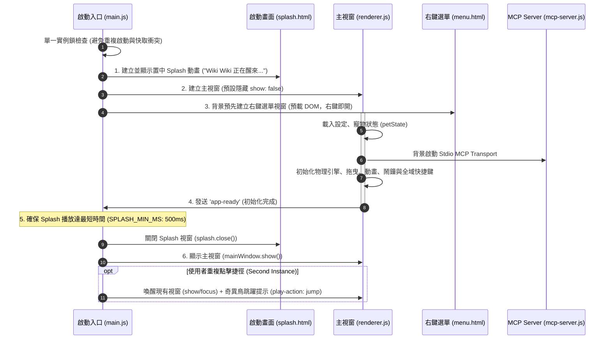

# 🥝 Wiki Wiki (AI 專屬桌面寵物)

<div align="center">


### 你的智慧、活潑、懂陪伴的透明桌面 AI 小助手
一款基於 Electron、Google Gemini 與 Model Context Protocol (MCP) 開發的次世代透明桌面寵物。外觀是一隻圓滾滾、愛撒嬌的奇異鳥 (Wiki Wiki)！

[](https://www.electronjs.org/)
[](https://nodejs.org/)
[](https://ai.google.dev/)
[](#-自動化測試與代碼品質-testing--qa)
[](LICENSE)

</div>

---

## ✨ 核心特色與亮點 (Core Features)

### 🧠 1. ReAct 自主 Agent 思考迴圈 & MCP 工具箱
- **自然語言工具調用**：不僅僅是聊天機器人！Wiki Wiki 採用完整的 **ReAct (Reasoning + Acting)** 思考機制，自主決定何時呼叫工具。
- **本地 MCP 伺服器整合**：
  - 「幫我戴上墨鏡或皇冠」➔ 自主呼叫換裝工具 (`set_outfit`)
  - 「今天晚上 7 點叫我吃晚餐」➔ 自動解析時間並排定鬧鐘 (`create_alarm`)
  - 「記一下等等要買牛奶」➔ 即時新增至待辦清單 (`add_todo`)
  - 「算一下 (120*4.5)+38」➔ 調用安全數學運算小工具 (`calculate`)
- **豐富對話卡片與 Markdown 渲染**：對話框支援完整的 GitHub 風格 Markdown 解析、語法高亮、一鍵複製代碼塊與獨立 Inspector 深度檢查視窗。

---

### 💡 2. 0-Token 智慧剪貼簿主動感知引擎
- **本地極速正規化分析**：在完全**不消耗任何 API Token** 的前提下，於本機毫秒級辨識複製內容意圖：
  - 💻 **CLI 指令與腳本**（Python, Bash, npm, Git 等）
  - 🚨 **程式錯誤與堆疊日誌 (Stack Trace)**
  - 📁 **本機檔案路徑與目錄**
  - 🔠 **單詞查詢與跨語言段落翻譯**
  - 📋 **JSON 結構化資料**
- **非侵入式燈泡微提示**：偵測到技術內容時，於奇異鳥頭頂浮現可愛的燈泡 Badge，點擊即可一鍵呼叫 AI 進行解讀、除錯、說明或轉換。
- **嚴謹的隱私防護**：剪貼簿感知與主動讀取預設全面關閉，由使用者在設定中心完全掌控授權。

---

### ⏰ 3. 鬧鐘三階段「頑皮跟隨」與游標周遭漫步系統
鬧鐘響起時，若主人專注於手頭工作未即時按掉，Wiki Wiki 會開啟漸進式趣味催促狀態機：

```
【階段 1：原地提醒】 (0 ~ 15 秒)
   • 奇異鳥在原地輕跳，氣泡顯示鬧鐘標題與操作按鈕。
   • 頭頂配件：⏰｜播放 Web Audio 輕脆鳥鳴提示音。
        │
        ▼ (超時未按掉，預設 15 秒)
【階段 2：起步尋找】 (15 ~ 35 秒)
   • 邁開小碎步朝滑鼠游標走來，自動面向滑鼠螢幕座標 (--flip)。
   • 頭頂配件：💦｜對白演進：「咦？你沒看見嗎？時間到了喔～👀」
        │
        ▼ (進入安全距離 / 超過 35 秒)
【階段 3：游標周遭漫步】 (35 秒以上)
   • 圍繞滑鼠以安全橢圓半徑慢步踱步，絕不遮擋滑鼠點擊焦點。
   • 頭頂配件：❗｜催促對白：「抓到你的滑鼠了！快按掉我～🐥💥」
        │
        ▼ (點擊「我知道了」或「稍後提醒」)
【解除回歸與自然走動】
   • 點擊「我知道了」：開心大跳躍 + 愛心 ❤️，0.5 秒後立即出發漫步。
   • 點擊「稍後提醒」：放鬆輕跳 + 沙漏 ⏳ + 溫柔告別對白，0.5 秒後同樣自然出發走動。
```

- **跨螢幕瞬間跳躍 (Multi-Monitor Teleport Jump)**：當游標跨至其他螢幕時，奇異鳥能精準跨螢幕追蹤，瞬間跳躍過去並喊出「咻～跳躍！✨」，徹底消除邊緣卡死問題。
- **懸停近身保護 (Click Zone Freeze)**：當使用者滑鼠游標靠近或懸停在奇異鳥身上時，會立即安靜定格停步，方便從容點擊操作。

---

### 🎛️ 4. iOS 風格現代鬧鐘管理介面
- **二合一時間 Combobox**：輸入框與下拉選單融為一體，兼具鍵盤直接輸入的彈性與選單快捷選擇的便利，自動去除多餘雙層邊框。
- **3D 無限循環滾輪選擇器 (Wheel Picker)**：
  - 忠實還原 iOS 鬧鐘經典滾輪體驗，數字永遠中央高亮聚焦鏡頭。
  - 支援 5 週期雙向無縫循環無界滾動、3D 曲面景深漸變。
  - 支援滑鼠滾輪、滑鼠拖曳、點擊直達與鍵盤雙向即時同步。
- **iOS 質感 Switch 開關**：一鍵啟用/停用鬧鐘，伴隨動態氣泡確認回饋。
- **快捷時間膠囊**：提供「現在」、「+15分」、「+30分」、「+1小時」一鍵快速填入。

---

### 🔴 5. 紅點雷射筆休閒小遊戲 (Laser Pointer)
- 從右鍵選單開啟「🔴 雷射筆遊戲」，滑鼠游標化身為發光紅點！
- 奇異鳥會興奮奔跑追逐紅點並嘗試撲抓，伴隨即時抓捕計分與豐富的台詞回饋。
- 支援逾時自動結算、按 `ESC` 或按右鍵即可隨時結束退出。

---

### 📊 6. 四象限分類設定中心 & AI 用量儀表板
- **一般設定 (General)**：
  - Gemini API Key 配置與動態模型下拉清單（支援一鍵重新整理載入可用模型）。
  - **AI 用量與配額監控儀表板**：即時掌握 RPM 頻率狀態、今日請求數進度條、每日 15:00 免費額度重設倒數計時、Token 消耗統計。
  - **AI 個性切換**：預設模式（親切小幫手）、吟遊詩人模式（押韻節奏）、傲嬌模式（嘴硬心軟）、自訂模式（客製化 15 字個性描述）。
  - **上下文記憶時間**：1 分鐘、5 分鐘（預設）、15 分鐘、30 分鐘、1 小時或永久保留。
- **隱私規範 (Privacy)**：
  - 讀取系統剪貼簿權限（預設關閉）。
  - 剪貼簿主動感知浮動提示開關（預設關閉）。
- **外觀與互動 (Appearance)**：
  - 床鋪狀態與位置微調（X/Y 軸偏移、縮放大小、前景/背景圖層順序）。
  - 呼吸動畫速度微調。
  - 全域召喚快捷鍵錄製與自訂。
  - 鬧鐘逾時頑皮跟隨開關與啟動延遲（10 秒 / 15 秒 / 30 秒）。
  - Web Audio 鬧鐘提示鳥鳴聲開關。
- **關於與更新 (About)**：
  - 版本資訊、GitHub 專案連結、線上檢查更新。

---

### 🍎 7. 陪伴養成、換裝與桌面日常
- **🖼️ 透明無邊框 (Frameless & Transparent)**：完全融入桌面，支援全螢幕工作區防越界邊界限制。
- **🖱️ 隨意拖曳 (Draggable)**：隨時按住奇異鳥拖曳至螢幕任意位置。
- **🚶 60fps 平滑隨機走動**：原地小步漫步，帶有 5% 長途跋涉漫遊機制；交談、工作或睡覺時自律停步。
- **🍎 摸摸與餵食**：右鍵選單即時投餵與撫摸，觸發歡樂跳躍與愛心 ❤️ 動畫。
- **👔 豐富衣櫥換裝**：內建太陽眼鏡、皇冠、領結、巫師帽等多款飾品，支援手動換裝與 AI 語音換裝。
- **💦 CPU 系統負載監控**：自動偵測主機資源消耗，負載偏高時奇異鳥會跟著冒汗 💦！
- **🔊 原生 Web Audio 輕量音效**：使用瀏覽器音訊合成雙音鳥鳴與放鬆滑音，無需外掛龐大音效檔案。

---

## ⌨️ 快捷鍵與內建指令 (Shortcuts & Commands)

### 快捷鍵操作
| 按鍵組合 | 功能說明 |
| :--- | :--- |
| `Ctrl + Shift + K` (預設，可於設定自訂) | **全域召喚咒語**：奇異鳥立即傳送至滑鼠當前游標處 |
| `Escape` | 快速關閉當前開啟的輸入框、對話氣泡、鬧鐘或結束雷射筆遊戲 |
| `滑鼠右鍵` (於奇異鳥身上) | 開啟右鍵功能選單（餵食、撫摸、換裝、鬧鐘、待辦、歷史、設定等） |
| `滑鼠右鍵` (於雷射筆遊戲時) | 立即結束雷射筆遊戲並結算分數 |

### 內建斜線快捷指令 (`/`)
在輸入框輸入 `/` 並搭配 `TAB` 鍵可快速自動補齊：
- `/todo [待辦事項]` - 快速加入待辦任務
- `/pomodoro [分鐘數]` - 開啟番茄鐘專注模式（奇異鳥進入專注靜止狀態）
- `/calc [算式]` - 安全運算式數學計算（如 `/calc (500*0.8)+150`）
- `/base64 encode/decode [字串]` - Base64 編碼與解碼
- `/md5 [字串]` - 計算 MD5 雜湊值（若省略字串則自動讀取系統剪貼簿，計算後自動寫回剪貼簿）
- `/uuid` - 產生一組標準 UUID

> 💡 **自然語言支援**：亦可直接以自然語言對 Wiki Wiki 說「*幫我把 123456 轉成 md5*」或「*把剪貼簿的內容轉成 md5 存到待辦事項*」，Agent 會自動呼叫 `compute_hash` 工具精準計算並自動複製結果！

---

## 🔄 應用程式生命週期 (Application Lifecycle)

Wiki Wiki 採用 **Splash 動畫先行 + 背景非同步預熱 (Background Preloading) + 單一實例鎖 (Single Instance Lock)** 架構，兼顧無白屏平滑啟動與資源防衝撞：



---

## 🛡️ 資料管理與安全隱私 (Data & Privacy)

- **本機優先與結構化持久層**：所有資料皆保存在專案目錄下的 `data/` 資料夾中：
  - `pet_state.json`：寵物外觀、位置、數值與設定
  - `alarms.json`：智慧鬧鐘排程
  - `todo.json`：待辦任務清單
  - `chat_history.dat`：聊天記錄（**AES-256 加密保存**）
- **零隱私洩漏設計**：剪貼簿感知採用離線正則匹配，在使用者主動點擊前不會上傳任何內容至 AI。

---

## 🧪 自動化測試與代碼品質 (Testing & QA)

專案配備嚴格的雙重自動化測試體系，確保核心演算法與介面狀態機的極致穩定：

```bash
# 執行原生 Node.js 單元測試 (42 項測試：語料管理、加密、剪貼簿引擎、安全路徑、用量計算等)
npm test

# 執行 Jest UI 整合測試 (26 項測試：換裝、鬧鐘排程、三階段狀態機、游標感知、防衝突防護等)
npm run test:ui

# 執行 ESLint 程式碼品質與風格檢查
npm run lint
```

---

## 📥 下載與安裝說明 (Installation Notice)

您可以直接前往 [GitHub Releases](https://github.com/NCard/codex-pet/releases) 下載最新的 Windows 安裝檔 (`Wiki-Wiki-Setup-x.x.x.exe`)。

> [!NOTE]
> **🛡️ Windows SmartScreen 安全防護提示：**  
> 本軟體為免費開源專案，未購買昂貴商業數位憑證。若雙擊 `.exe` 安裝檔時 Windows 跳出「**Windows 已經保護您的電腦 (未知發行者)**」藍色警告畫面：
> 1. 請點擊畫面上的 **「更多資訊 (More info)」**
> 2. 點擊下方出現的 **「仍要執行 (Run anyway)」** 即可正常安裝與開啟！

---

## 🚀 開發者快速上手 (Development)

### 1. 環境需求
- [Node.js](https://nodejs.org/) (建議 v18 以上)
- npm (內建於 Node.js)
- [Google Gemini API Key](https://aistudio.google.com/)

### 2. 安裝依賴與配置
```bash
# 複製專案
git clone https://github.com/NCard/codex-pet.git
cd codex-pet

# 安裝依賴套件
npm install

# 配置金鑰 (可直接在專案根目錄建立 .env 檔案，或於啟動後在「設定中心」輸入)
echo "GEMINI_API_KEY=your_gemini_api_key_here" > .env
```

### 3. 啟動應用程式
```bash
npm start
```

### 4. 打包成 Windows 獨立安裝檔 (.exe)
```bash
npm run dist
```
打包完成後，可攜式與 NSIS 安裝程式將輸出於 `dist/` 目錄中。

---

<div align="center">
Made with ❤️ for Wiki Wiki Lovers
</div>
