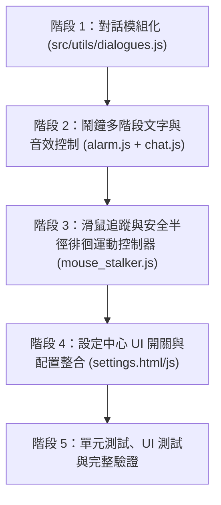

# 🐣 Wiki Wiki 互動體驗優化與對話模組化規格書 (Interaction Enhancement & Dialogue Modularization Plan)

> **版本目標**：v1.4.0  
> **分支**：`feature/pet-interaction-enhancements`  
> **狀態**：已完成 (Completed)  
> **更新日期**：2026-11-10

---

## 📋 總覽目錄

1. [優化背景與核心目標](#1-優化背景與核心目標)
2. [項目一：獨立對話與語料管理模組 (`dialogues.js`)](#項目一獨立對話與語料管理模組-dialoguesjs)
3. [項目二：鬧鐘超時「頑皮跟隨與滑鼠周圍徘徊」機制](#項目二鬧鐘超時頑皮跟隨與滑鼠周圍徘徊機制)
4. [項目三：視覺表情與微交互回饋強化](#項目三視覺表情與微交互回饋強化)
5. [項目四：輕量化 Web Audio 提示音效](#項目四輕量化-web-audio-提示音效)
6. [項目五：設定中心「頑皮催促」開關與個人化選項](#項目五設定中心頑皮催促開關與個人化選項)
7. [項目六：智慧防遮擋與多螢幕邊界安全防護](#項目六智慧防遮擋與多螢幕邊界安全防護)
8. [實作階段與執行里程碑](#實作階段與執行里程碑)

---

## 1. 優化背景與核心目標

Wiki Wiki 在 v1.3.0 成功建立了自主 ReAct Agent 引擎與智慧剪貼簿感知，具備強大的桌面助手功能。然而在日常生活陪伴層面：
- **對話文本分散**：台詞寫死在各邏輯模組中（`chat.js`、`menus.js`、`laser.js`），不利於擴充、維護與隨機趣味性。
- **鬧鐘互動性單一**：時間到達時僅在原地彈出氣泡，若使用者專注於工作未注意，缺乏生動有趣的催促與微互動機制。

本版本以**「提升生命感、趣味性與代碼模組化」**為核心，將對話語料全數抽離獨立，並賦予奇異鳥在鬧鐘超時未關閉時，主動尋找滑鼠、在游標周遭徘徊撒嬌催促的能力。

---

## 項目一：獨立對話與語料管理模組 (`dialogues.js`)

### 1.1 設計理念
將專案中所有靜態字串、隨機台詞、表情符號、日常互動語句與情境提示詞全數抽離至獨立模組 [`src/utils/dialogues.js`](../src/utils/dialogues.js)，提供統一的查詢與隨機抽取 API。

### 1.2 模組職責劃分
- **`summon`**：全域召喚台詞（5+ 句隨機輪播）
- **`interactions`**：
  - `feed`：餵食滿意台詞
  - `pet`：撫摸互動舒爽反饋
  - `sleep`：就寢晚安台詞
- **`laser`**：雷射筆遊戲開場、捕獲、逾時與結算語句
- **`alarm`**：鬧鐘三階段催促對白（依時間漸進演化）
- **`personalityPrompts`**：AI 個性系統提示詞（Default / Bard / Grumpy / Custom）

### 1.3 核心 API 設計
```javascript
// 取得指定情境的隨機台詞
function getDialogue(category, key, options = {}) {
  // 支援根據目前個性 (personality) 提供差異化對白
  // 支援字串模板插值 (如 ${alarm.message})
}
```

---

## 項目二：鬧鐘超時「頑皮跟隨與滑鼠周圍徘徊」機制

### 2.1 三階段漸進式行為狀態機

```
[鬧鐘時間到]
     │
     ▼
【階段 1：原地提醒】 (0 ~ 15 秒)
   • 奇異鳥在原地輕跳，氣泡顯示原鬧鐘訊息。
   • 對白：「⏰ 提醒：[鬧鐘訊息]」
     │
     ▼ (超過 15 秒未按掉)
【階段 2：起步尋找】 (15 ~ 35 秒)
   • 切換至 walking 走路姿態，自動面向滑鼠螢幕座標 (--flip)。
   • 以穩定慢速 (stepSpeed: 1.8) 朝滑鼠移動。
   • 對白演進：「咦？你沒看見嗎？時間到了喔～👀」
     │
     ▼ (到達安全半徑 / 超過 35 秒)
【階段 3：游標周遭徘徊】 (35 秒以上)
   • 進入滑鼠周圍安全半徑 (100px ~ 150px)，絕不遮擋滑鼠點擊焦點。
   • 圍繞滑鼠以正弦波/圓形或小碎步左右踱步探頭。
   • 對白演進：「抓到你的滑鼠了！快按掉我～🐥💥」「不可以裝作沒看見我！🐾」
     │
     ▼ (點擊「我知道了 / 稍後提醒」或按 Esc)
【解除回歸】
   • 奇異鳥開心跳躍，氣泡關閉，回歸閒置/漫遊狀態。
```

### 2.2 核心參數配置
- `STAGE_1_DELAY_MS`: 15,000 ms (原地提醒持續時間)
- `STAGE_2_SPEED`: 1.8 px/frame (朝滑鼠移動速度，緩慢不突兀)
- `SAFE_ORBIT_RADIUS`: 120 px (游標安全距離，避免擋住工作視窗)
- `ORBIT_SPEED`: 0.03 rad/frame (環繞/徘徊角速度)

---

## 項目三：視覺表情與微交互回饋強化

- **頭頂配件動態連動**：
  - 階段 1：顯示鬧鐘圖示 `⏰`
  - 階段 2：切換為著急汗珠 `💦` 或疑惑 `❓`
  - 階段 3：切換為大驚嘆號 `❗` 或眼神晃動
- **小動作微交互**：
  - 在徘徊過程中，每隔 8 秒隨機輕微跳動或左右搖頭，表現著急但可愛的肢體語言。
  - 使用者點擊按鈕解除時，觸發「鬆了一口氣」的放鬆眨眼與愛心 `❤️`。

---

## 項目四：輕量化 Web Audio 提示音效

- **零額外檔案依賴**：
  - 採用瀏覽器原生 `AudioContext` 振盪器 (`OscillatorNode` + `GainNode`)。
  - 合成清脆雙音鳥鳴（例如 880Hz -> 1320Hz 柔和正弦波）或晶瑩叮咚聲。
- **免除外部依賴**：不需額外打包數 MB 的音效 mp3，啟動 0 延遲。
- **音量與開關控制**：使用者可在設定中自由靜音或調校音量大小。

---

## 項目五：設定中心「頑皮催促」開關與個人化選項

於「設定中心 ➔ 外觀與互動」分頁新增以下控制項：
1. **鬧鐘逾時主動靠近催促**（Toggle 開關，預設開啟）：
   - 開啟：超時未關閉則啟動滑鼠追蹤與周遭徘徊。
   - 關閉：維持原版本地原地氣泡提示。
2. **啟動跟隨延遲秒數**（拉桿或下拉選單：10s / 15s / 30s，預設 15s）。
3. **鬧鐘提示音**（Toggle 開關 + 音量滑桿）。

---

## 項目六：智慧防遮擋與多螢幕邊界安全防護

- **滑鼠焦點防遮擋 (Cursor Clearance)**：
  - 奇異鳥計算終點座標時，強制保留 `offset = 120px`（偏向滑鼠側後方），保證滑鼠游標正下方的點擊與選取不受任何遮蔽。
- **螢幕邊界邊緣拘束 (Screen Bounds Guard)**：
  - 當滑鼠移至工作列或多螢幕交界邊緣時，奇異鳥邊界檢查自動將視窗限制在可視區域 (`screen.availTop/Left/Width/Height`) 內，杜絕寵物走失卡在螢幕外。
- **緊急退出機制 (Esc / 拖曳)**：
  - 催促跟隨期間，若使用者按下 `Esc` 或直接拖曳奇異鳥，立即暫停該次追蹤並原地待命。

---

## 實作階段與執行里程碑



| 階段 | 預計工作項目 | 產出與驗證 | 狀態 |
| :---: | :--- | :--- | :---: |
| **Milestone 0** | 修復鬧鐘閃退、ESC 重複監聽與智慧剪貼簿 Badge 衝突 | `alarm_protection.test.js` 全數通過 | ✅ 完成 |
| **Milestone 1** | 抽出 `dialogues.js`，將召喚、互動、雷射、個性等字串集中 | `dialogues.test.js` 通過，所有模組語料解耦 | ✅ 完成 |
| **Milestone 2** | 在 `chat.js` 與 `alarm.js` 實現鬧鐘三階段計時與動態對白演變 | 倒數計時測試、對白平滑切換 | ✅ 完成 |
| **Milestone 3** | 開發滑鼠追蹤運動引擎（平滑靠近、安全半徑繞步、朝向翻轉） | 畫面平順跟隨，無閃爍或邊界越界 | ✅ 完成 |
| **Milestone 4** | 設定中心加入「頑皮跟隨」開關與延遲秒數設定 | 設定即時存取與生效，支援 Web Audio 原生音效 | ✅ 完成 |
| **Milestone 5** | 全套單元測試、UI 測試與多螢幕邊界拘束強化 | 修正邊緣卡死與多螢幕支援，42 單元測試 + 18 UI 測試 100% 通過，0 ESLint 錯誤 | ✅ 完成 |
| **Milestone 6** | 漫步節奏調優與點擊防護 (Click Zone Freeze) | 降速至原生漫步步長 (1.2~1.8)、周遭歇息慢步、滑鼠接近按鈕時立即靜止方便點選 | ✅ 完成 |
| **Milestone 7** | 跨螢幕傳送跳躍與跳躍台詞 (Multi-Monitor Teleport Jump) | 多螢幕游標感知 (左/中/右)，跨螢幕即刻瞬間移動並喊出「咻～跳躍！✨」，消除右螢幕邊緣卡死 | ✅ 完成 |
| **Milestone 8** | 鬧鐘排程介面二合一時間 Combobox 與 Switch 升級 | 輸入與下拉選單合而為一 (隱藏浮動 popover)，保留鍵盤任意輸入彈性，iOS Switch 開關與啟用通報 | ✅ 完成 |

